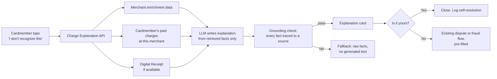

# Charge Clarity: explaining unrecognized charges before they become disputes

A product case study by Saundarya Verma (NYU Tandon, M.S. Management of Technology).

> Independent concept written for practice. It isn't affiliated with or endorsed by American Express and uses only public information. Every number marked *assumption* is an estimate I made to size the idea, not real data.

## 1. The problem

A cardmember opens their statement, sees `SQ *BLUEBTL 8823 NY` and doesn't recognize it. They don't know it was the coffee shop around the corner, so they call or file a dispute. The charge was valid, but now there's a dispute to work, a merchant hit with a chargeback, and a customer who spent ten minutes worried their card was stolen.

The evidence that this is common:

- Confusing or unrecognizable billing descriptors were the leading cause of chargebacks among cardholders surveyed in Chargebacks911's 2024 field report. In the same survey, 53% of cardholders disputed a transaction with their bank without contacting the retailer first. ([Chargebacks911](https://chargebacks911.com/the-2024-chargeback-field-report-is-here/))
- Amex's own Trendex research found 70% of US consumers had contacted their card company about a charge they thought was fraudulent or wrong, but which was actually valid. ([PYMNTS, 2021](https://www.pymnts.com/news/payments-innovation/2021/american-express-launches-digital-receipts-feature-to-provide-transaction-detail))
- Amex already attacks this with Digital Receipts, which show item-level purchase details for select merchants such as Apple, Google, Microsoft and Square. The gap is every merchant outside that program.

**Problem statement:** Cardmembers can't identify a valid charge from the statement alone, so they use the most expensive path we offer (calls and disputes) to answer a simple question: "what is this?"

## 2. Who it's for

| User | Job to be done | Today |
|---|---|---|
| Cardmember who sees an unfamiliar charge | "Help me figure out if this is mine, quickly, without calling anyone." | Googles the descriptor, calls, or disputes |
| Customer care colleague | "Let me close 'what is this charge' calls fast and spend my time on real fraud." | Looks up the merchant manually during the call |
| Disputes and fraud operations | "Send me real fraud, not confused customers." | Works disputes that end in "valid charge" |

## 3. Hypotheses

- **H1:** If we show a plain-language explanation of a charge (merchant's real name, location, logo, and what the cardmember probably bought, based on their own history with that merchant), at least 30% of cardmembers who tap "I don't recognize this" will confirm the charge instead of disputing it. *(target is an assumption)*
- **H2:** Showing the explanation *before* the dispute form, not after, increases self-resolution without reducing real fraud reports.
- **H3:** Customer care calls tagged "unrecognized charge" fall when the feature is available.

## 4. Goals and non-goals

**Goals**
- Fewer disputes and calls about valid charges.
- Faster answer for the cardmember: under 30 seconds from "what is this?" to a decision.
- No drop in real fraud caught.

**Non-goals for v1**
- Replacing the dispute or fraud flow. A cardmember can always dispute in one tap.
- Item-level receipts for every merchant. Digital Receipts already handles partners.
- Any automated decision about a dispute. The AI explains; humans and existing systems decide.

## 5. User stories and acceptance criteria

**Story 1.** As a cardmember, when I don't recognize a charge, I want to see who the merchant really is so I can decide if it's mine.
- Given a transaction with an enriched merchant record, when I tap "I don't recognize this," then I see the merchant's real name, logo, address on a map, and category within 2 seconds.
- Given no enriched record, then I see the raw descriptor, what we do know, and a clear "Dispute this charge" button. No guessing.

**Story 2.** As a cardmember, I want to know if I've paid this merchant before.
- Given I have prior charges at the same merchant, then I see "You've paid this merchant 4 times since March, usually $5–$7."
- The summary uses only my own transaction history.

**Story 3.** As a cardmember, I want the dispute option to stay one tap away.
- On every explanation screen, "This isn't mine" goes straight to the existing dispute or fraud flow with the transaction pre-filled.

**Story 4.** As a care colleague, I want the same explanation on my screen during a call.
- When a call is tagged "unrecognized charge," the explanation card appears in the colleague's tool for that transaction.

**Story 5.** As a fraud analyst, I want to know when someone saw an explanation and still disputed.
- Disputes filed after viewing an explanation carry a flag and the explanation shown, so analysts can review them and find bad explanations.

## 6. Solution (v1)

1. On any transaction, the cardmember taps **"I don't recognize this."**
2. The app calls a **Charge Explanation API** with the transaction ID.
3. The service pulls the merchant enrichment record (clean name, logo, location, category), the cardmember's past charges at that merchant, and Digital Receipt data if it exists.
4. A generative AI model writes a two-sentence explanation **only from those retrieved facts**. If a fact isn't in the data, it doesn't appear in the text.
5. The cardmember chooses **"Yes, it's mine"** or **"This isn't mine,"** which opens the dispute flow pre-filled.

## 7. Responsible AI and human-in-the-loop

- **Grounded output only.** Every name, place, date and amount in the explanation must trace back to a retrieved record. A check runs before display. If it fails, the cardmember sees the raw facts instead of generated text. (I built the same "verify every quote against its source" check in my [Clausewise](https://github.com/saundaryaverma/Clausewise) project.)
- **The model never decides.** It doesn't approve, deny or discourage disputes. The tone guide bans phrasing like "you probably made this purchase."
- **Humans review the edge cases.** Disputes filed after an explanation are flagged for fraud analysts, and a weekly sample of explanations is reviewed by people for accuracy and tone.
- **Privacy.** The model sees only this cardmember's data for this merchant. No data from other cardmembers.
- **Evaluation before launch.** A regression suite of real descriptor cases runs on every model or prompt change and blocks release if accuracy or grounding drops. (Same approach as my [Driftwatch](https://github.com/saundaryaverma/Driftwatch) tool.)

## 8. Prioritization

RICE scores for the candidate features. Reach and impact are *assumptions* for sizing, scored 1–3 for impact.

| Feature | Reach | Impact | Confidence | Effort (person-weeks) | RICE | Decision |
|---|---|---|---|---|---|---|
| Merchant identity card (name, logo, map) | High | 2 | 80% | 3 | Highest | **v1** |
| "You've paid them before" history | High | 3 | 70% | 2 | High | **v1** |
| AI two-sentence explanation | High | 2 | 50% | 5 | Medium | **v1, behind a flag** |
| Explanation in care colleague tool | Medium | 2 | 70% | 3 | Medium | v1.1 |
| Proactive alert for first-time merchants | High | 1 | 40% | 6 | Low | Later |

The AI explanation goes behind a feature flag. If the identity card and history alone deliver most of the result, that's cheaper and lower risk, and the experiment will show it.

## 9. Success measures

**North star:** share of "I don't recognize this" sessions that end with the cardmember confirming the charge as theirs.

| Type | Metric | Target *(assumption)* |
|---|---|---|
| Outcome | Disputes later closed as "valid charge," per 1,000 active cards | −15% |
| Outcome | Care calls tagged "unrecognized charge" | −10% |
| Experience | Median time from tap to decision | < 30 seconds |
| Experience | Cardmember satisfaction on the explanation screen | ≥ 4.2 / 5 |
| **Guardrail** | Confirmed fraud reported within 60 days on transactions the cardmember marked "mine" | No increase vs. control |
| **Guardrail** | Explanations failing the grounding check | < 1% |

The fraud guardrail matters most. If cardmembers start confirming charges that turn out to be fraud, the feature is causing harm, and it stops.

## 10. Launch and post-launch learning plan

1. **Internal pilot:** colleagues use it on their own cards for two weeks. Review every explanation by hand.
2. **A/B test, 5% of US consumer cardmembers:** treatment sees the feature, control sees today's flow. Run until the dispute metric reaches significance.
3. **Ramp to 25%, then 100%** if guardrails hold at each stage.
4. **Post-launch:** weekly review of disputed-after-explanation cases, monthly read on the metrics, and a 90-day retro with care, disputes and fraud partners.

## 11. Risks and how I'd handle them

| Risk | Mitigation |
|---|---|
| Wrong explanation makes a fraud victim think a fraudulent charge is theirs | Grounding check; no generated text without data; fraud guardrail metric; dispute stays one tap away |
| Merchant enrichment coverage is thin for small merchants | v1 measures coverage first; fallback shows raw facts honestly |
| Model cost at scale | Cache explanations per merchant and descriptor; generate only on tap |
| Regulatory review of dispute-flow changes | Bring compliance and legal in at discovery, not at launch; no change to dispute rights or timelines |

## 12. Partners

Engineering (API and app), design (explanation card and tone), data science (experiment design), customer care, disputes operations, fraud risk, compliance, and the Digital Receipts team.

## 13. Open questions I'd answer in discovery

- What share of "valid charge" disputes come from descriptor confusion, versus forgotten subscriptions or family members using the card? Each needs a different fix.
- How good is merchant enrichment coverage outside large merchants?
- Would cardmembers trust an AI explanation more or less than a plain merchant card? This needs usability testing with 8–10 cardmembers before building the AI piece.
